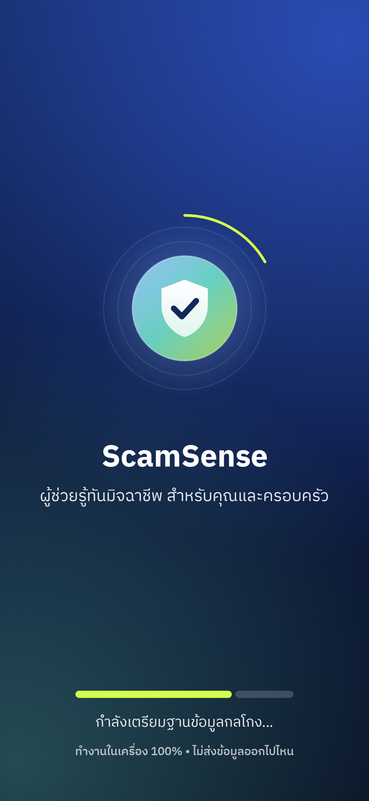
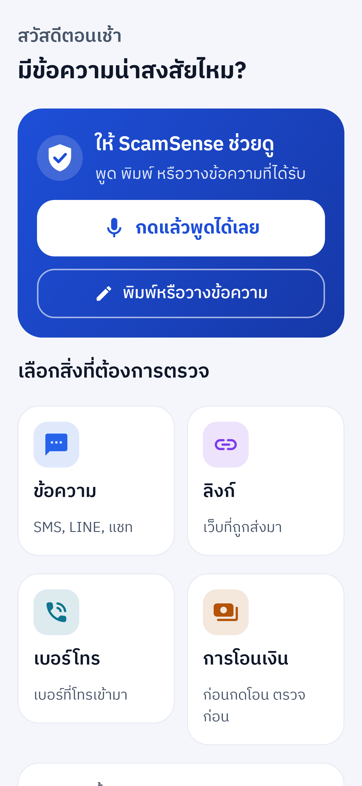
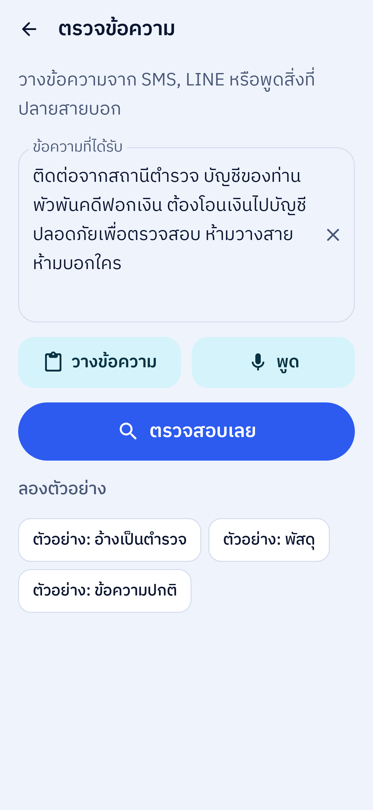
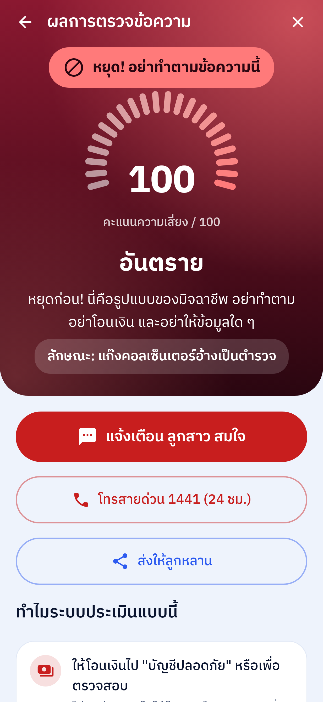
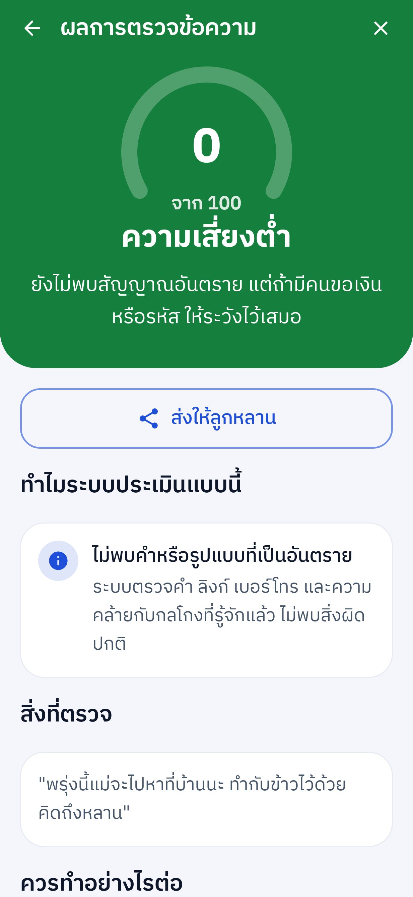
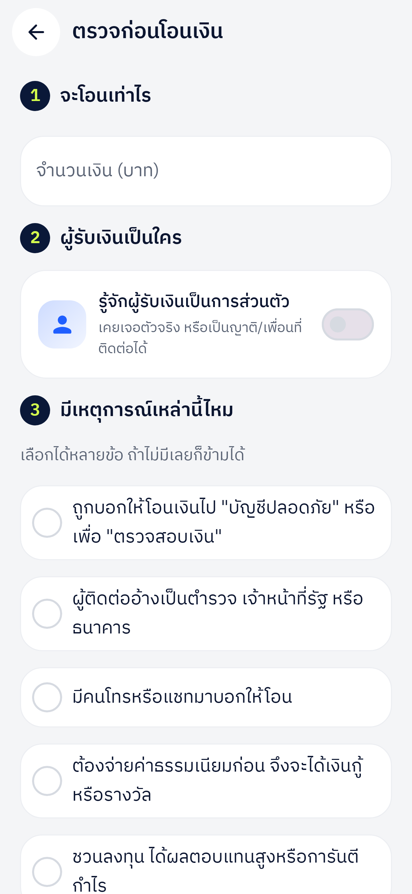
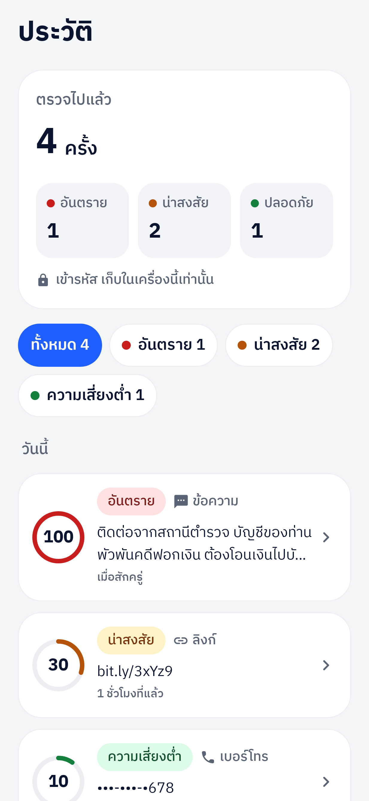
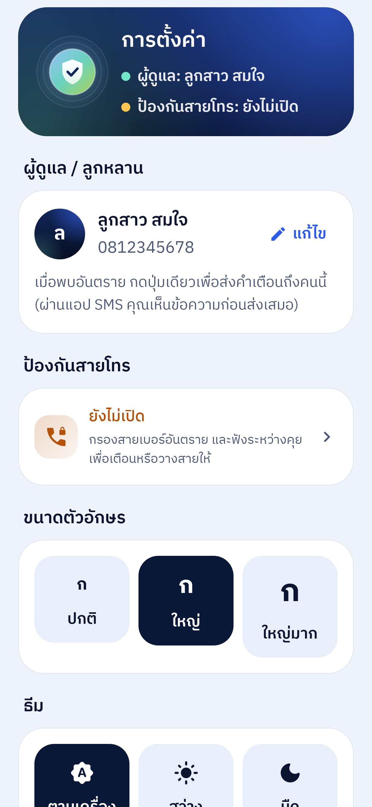
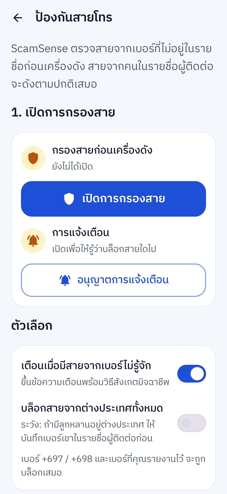
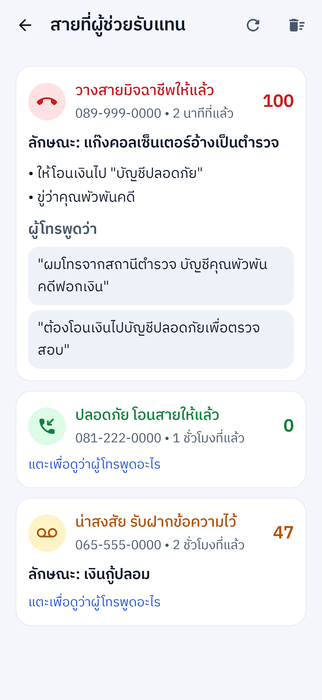

# ScamSense — ผู้ช่วยรู้ทันมิจฉาชีพ (Android)

ระบบคัดกรองและแจ้งเตือนความเสี่ยงภัยการเงิน/มิจฉาชีพ สำหรับผู้สูงอายุและผู้ดูแล
ตรวจ **ข้อความ (SMS/LINE)**, **ลิงก์**, **เบอร์โทร** และ **การโอนเงิน** → ให้คะแนนความเสี่ยง 0–100
พร้อมอธิบายเหตุผลเป็นภาษาไทยที่เข้าใจง่าย และส่งคำเตือนถึงผู้ดูแลได้ในปุ่มเดียว

| | |
|---|---|
| แพลตฟอร์ม | Android 6.0 (API 23) – Android 15 (API 35) • มือถือ/แท็บเล็ต • โหมดสว่าง/มืด |
| ความเป็นส่วนตัว | ตรวจข้อความ/ลิงก์/เบอร์ในเครื่อง 100% • อินเทอร์เน็ตใช้เฉพาะเมื่อจับคู่ผู้ช่วย AI รับสาย (HTTPS) |
| ภาษา | ไทย (ฟอนต์ IBM Plex Sans Thai ฝังในแอป) |
| ไฟล์ส่งมอบ | `dist/ScamSense-v1.3.2.apk` • `mockup/ScamSense-Mockup.html` • เซิร์ฟเวอร์ผู้ช่วย AI: `server/` |

## ฟีเจอร์

- **พูดเพื่อตรวจ (Speech-to-text)** — กด "กดแล้วพูดได้เลย" แล้วพูดสิ่งที่ได้รับ/ปลายสายบอก (ใช้ตัวรู้จำเสียงของระบบ จึงไม่ต้องขอสิทธิ์ไมโครโฟน)
- **ตรวจข้อความ** — กฎคำอันตราย 19 กลุ่ม (~300 คำ) + ทนต่อการเลี่ยงคำ (`บ.ช.ธนาคาร`, `O T P`, เลขไทย, ตัวอักษรหลอกตา, zero-width) + สะกดผิด 1 ตัว
- **เทียบความคล้ายของความหมาย (Concept: ไม่เทียบตรง ๆ)** — character n-gram TF-IDF + cosine similarity กับ 35 รูปแบบกลโกงที่รู้จัก (แทน Sentence2Vec/Word2Vec โดยไม่ต้องใช้โมเดลหนัก และไม่ต้องตัดคำภาษาไทย)
- **บล็อกทันที** — เมื่อพบคำ/การรวมกันที่อันตรายชัดเจน (ขอ OTP + เร่ง/ลิงก์, "บัญชีปลอดภัย", แอปควบคุมเครื่อง, ไฟล์ .apk, เว็บปลอมแบรนด์, เบอร์ +697/+698, คำที่ผู้ใช้ตั้งเอง) → ขึ้นป้าย "หยุด! อย่าทำตามข้อความนี้"
- **ตรวจลิงก์** (ไม่เปิดลิงก์จริง): เว็บปลอมธนาคาร/ขนส่ง, ลิงก์ย่อ, IP, punycode/homograph, `@` หลอกตา, TLD เสี่ยง, http
- **ตรวจเบอร์โทร**: เบอร์ต่างประเทศ, +697/+698, 1900, รูปแบบผิดปกติ, เทียบเบอร์ทางการ (1441, 1213, ธนาคาร ฯลฯ) พร้อมเตือนเรื่องการปลอมเบอร์
- **ตรวจก่อนโอนเงิน** — แบบถามตอบสั้น ๆ (บัญชีปลอดภัย, อ้างเจ้าหน้าที่, จ่ายค่าธรรมเนียมก่อน ฯลฯ)
- **แจ้งเตือนผู้ดูแล** (SMS ที่เติมข้อความให้แล้ว), **โทร 1441**, **ส่งต่อทาง LINE**, **ฟังผลเป็นเสียง (TTS)**
- **แชร์จากแอปอื่น / เลือกข้อความ → "ตรวจด้วย ScamSense"** ตรวจอัตโนมัติทันที
- **ป้องกันสายโทร (Android 10+)** — กรองสายจากเบอร์ที่ไม่อยู่ในรายชื่อก่อนเครื่องดัง: บล็อก +697/+698 / เบอร์ที่รายงาน / (ต่างประเทศ ถ้าเปิด) และแจ้งเตือน
- **ฟังระหว่างคุย (ทดลอง, ต้องใช้ Shizuku)** — ฟังเสียงปลายสายของเบอร์ไม่รู้จัก แปลงเป็นข้อความไทยในเครื่องด้วย whisper.cpp ถ้าพูดแบบมิจฉาชีพจะเตือนทันทีหรือวางสายให้อัตโนมัติ ([รายละเอียด](docs/LIVE_CALL.md))
- **ผู้ช่วย AI รับสายแทน** — สายเบอร์แปลกถูกโอนให้ผู้ช่วยรับ → ถอดเสียงเป็นข้อความ → ตรวจด้วยเอนจินเดียวกัน → **วางสายมิจฉาชีพให้อัตโนมัติ + SMS เตือนลูกหลาน** หรือโอนสายที่ปลอดภัยเข้ามาพร้อมสรุปให้ฟัง ([รายละเอียด](docs/CALL_ASSISTANT.md))
- ประวัติการตรวจแบบเข้ารหัส, ปรับขนาดตัวอักษร 3 ระดับ, ธีมมืด, หน้าโหลดแบรนด์ลื่นไหล

## Build

ต้องมี JDK 17+, Android SDK (platform 35, build-tools 35), NDK 27.2.12479018 และ CMake 3.22.1

```bash
git clone --recursive <repo>   # whisper.cpp อยู่ใน third_party/ เป็น submodule
```

```bash
echo "sdk.dir=/path/to/Android/sdk" > local.properties
./gradlew :core:test :server:test :app:testDebugUnitTest   # 94 tests: engine, call guard, server, UI render, flows
./gradlew lintRelease            # Android Lint (abortOnError)
./gradlew :app:assembleRelease   # R8-minified APK -> app/build/outputs/apk/release/
./gradlew :server:fatJar         # AI call assistant -> server/build/libs/scamsense-server.jar
```

**Release signing:** สร้าง `keystore.properties` (ไม่ถูก commit) ที่ root:
```properties
storeFile=release.jks
storePassword=...
keyAlias=scamsense
keyPassword=...
```
หากไม่มีไฟล์นี้ release build จะเซ็นด้วย debug key เพื่อให้ติดตั้งทดสอบได้ — **ห้ามนำไฟล์ที่เซ็นด้วย debug key ขึ้น Google Play**

รายละเอียดสถาปัตยกรรม: [docs/ARCHITECTURE.md](docs/ARCHITECTURE.md) • ความปลอดภัย: [docs/SECURITY.md](docs/SECURITY.md) • ผู้ช่วยรับสาย: [docs/CALL_ASSISTANT.md](docs/CALL_ASSISTANT.md)

> ScamSense เป็นเครื่องมือช่วยประเมินเบื้องต้น ไม่สามารถรับประกันได้ 100% — หากสงสัยให้ปรึกษาคนที่ไว้ใจหรือโทรสายด่วน 1441 เสมอ

## Screenshots (rendered from the real app by `ScreenRenderTest`)

| Loading | Home | Check | Result: danger |
|---|---|---|---|
|  |  |  |  |
| **Result: safe** | **Transfer check** | **History** | **Settings** |
|  |  |  |  |
| **Call guard** | **AI assistant paired** | **AI call log** | |
|  |  |  | |

## License

ScamSense is free software under the **GNU GPL v3** (with the additional Section 7 terms inherited from ShizuCallRecorder) — see [LICENSE](LICENSE) and [NOTICE.md](NOTICE.md).
